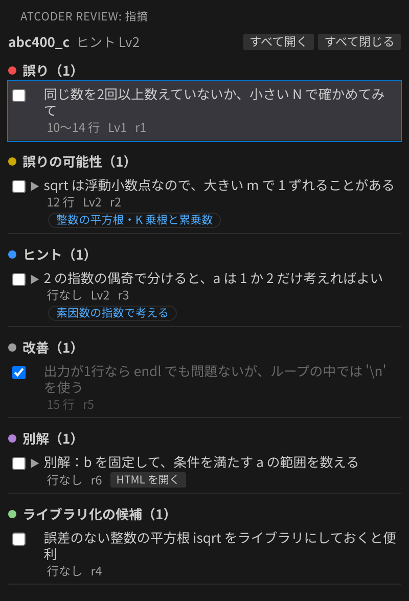
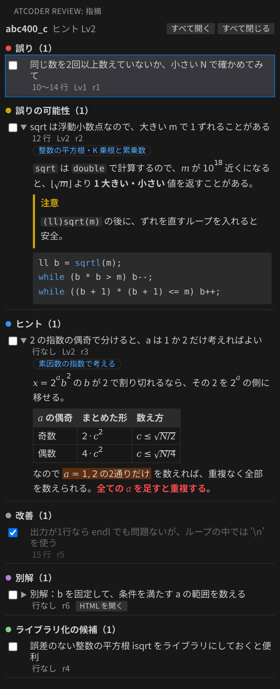
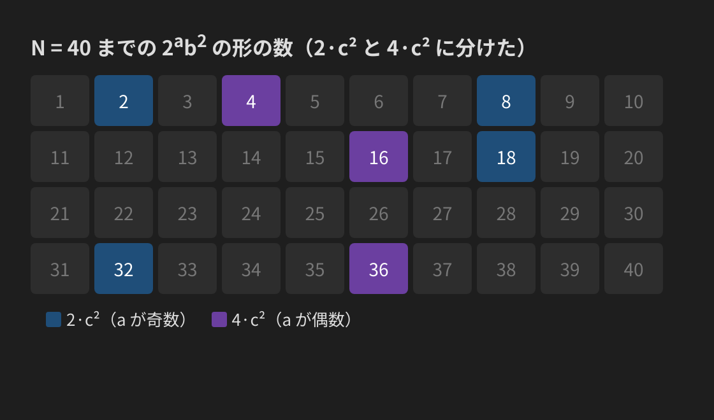

# kyopro-workbench

AtCoder（C++）で使う自作ライブラリと、精進を支える道具をまとめたリポジトリです。

| フォルダ | 中身 |
| --- | --- |
| `<ライブラリのフォルダ>/`（準備中） | 自作の C++ ライブラリ |
| [`_extensions/cph-fork/`](_extensions/cph-fork/) | cph を改造した VSCode 拡張（提出用にライブラリを展開する機能など） |
| [`_extensions/atcoder-review/`](_extensions/atcoder-review/) | Claude Code との連絡用の VSCode 拡張（指摘の表示、状態とテスト結果の書き出し） |
| [`_claude/`](_claude/) | 精進用の作業フォルダに置く Claude Code のテンプレート（CLAUDE.md・権限設定・スキル） |
| [`docs/`](docs/) | 設計・話し合い・決定事項 |

## ライブラリ

準備中です。方針は [docs/design.md](docs/design.md) と [docs/decisions/](docs/decisions/) にあります。

- 回答コードでは `#include "segtree.hpp"` のように短い名前で使えるようにします。`include/` に自動生成する転送用ヘッダを経由します（`include/` は git で管理しません）。
- 提出時は cph fork の「提出用にコピー」で、使ったライブラリを展開します。`// @impl` より下は main の後ろに移るので、main を上の方に保てます。

## cph fork

[Competitive Programming Helper (cph)](https://github.com/agrawal-d/competitive-programming-helper)（作者 Divyanshu Agrawal、GPL-3.0-or-later）を改造したものです。追加した機能、インストール方法（本家を無効にしてから入れる）、ビルド手順は [`_extensions/cph-fork/README.md`](_extensions/cph-fork/README.md) にあります。

## Claude Code との精進

AtCoder の過去問精進を、Claude Code との会話で支援する仕組みです。設計は [docs/dev/review-tool/design.md](docs/dev/review-tool/design.md) にあります。

- Claude はコードを書き換えません。指摘や解説はファイルに書き出され、レビュー拡張のパネルに表示されます（Markdown・数式・表に対応。図などは HTML のタブで開けます）。コードには文字を重ねず、指摘のある行のガターに印だけを出します。
- ヒントは段階的に出します（Lv1：気づくべき点 → Lv2：手法の名前 → Lv3：方針と実装の要点）。完全な解答は、AC を申告した後（`/coach-review`）かギブアップした後（`/coach-giveup`）だけです。
- WSL 2（Linux）を前提にしています。Linux・macOS でも動く想定ですが、Windows のネイティブ環境には対応していません。

<p>


</p>

左：種類ごと（誤り・誤りの可能性・ヒント・改善・別解・ライブラリ化の候補）に並んだ指摘。右：本文を開いたところ（数式・表・C++ のコード・注意の囲み・教材のリンク）。



図などは、Claude が書いた HTML をエディタのタブで開いて見られます。

（画像は見本のデータを、実際のパネルのコードで描いたものです）

### セットアップ

1. `_extensions/cph-fork/cph-fork.vsix` と `_extensions/atcoder-review/atcoder-review.vsix` を、VSCode の「Extensions: Install from VSIX...」でインストールする。本家の cph は無効にしておく。
2. テンプレートを作業フォルダ（精進に使うフォルダ）に置く。

   ```sh
   _claude/install.sh <作業フォルダ>
   ```

   `CLAUDE.md`、`.claude/settings.json`、`.claude/skills/coach-*` が置かれます。中身の違うファイルがすでにあれば、差分を表示して飛ばします（`--force` で上書き）。
3. cph fork の設定（`cph.bundle.includePaths` など）を自分の環境に合わせる。
4. 必要なら、自分用の設定を書く（install.sh はこれらに触れません）。
   - `.claude/settings.local.json`：atcoder.jp を開く時の承認を省く・禁止するなどの権限
   - `CLAUDE.local.md`：Claude への追加の指示（atcoder.jp を開いてよい場面を広げる、など）

   手で作ったこれらのファイルは、作業フォルダを Git で管理しているなら管理対象から外してください（Claude Code が自動で外すのは、Claude Code 自身が `settings.local.json` を作った時だけです）。
5. Claude Code で作業フォルダを開く（デスクトップアプリなら WSL セッションで）。

作業フォルダを Git で管理する場合は、`.atcoder-review/`、install.sh で置いたファイル、`CLAUDE.local.md` を管理対象から外すことを勧めます。

### 使い方（1問の流れ）

1. Competitive Companion で問題を取り込み、コードを書いて cph でサンプルを確かめる（テスト結果は自動で記録されます）。
2. 詰まったら、見てほしい所を選択したまま保存し、Claude Code に「ここ見て」や `/coach-hint 1` と話しかける。問題文はスクリーンショットか要約で渡す。
3. WA の原因が分からない時は `/coach-check`（問題文と実装の食い違いを探す）。
4. 指摘はパネルに種類ごとに出て、該当行のガターに印が付きます。見出しをクリックすると本文が開きます。直したらパネルで「対処済み」にチェックする。
5. AC したら `/coach-review` で添削と別解。諦める時は `/coach-giveup`。
6. 次の問題に移る前に `/clear` で会話を区切る（記録するなら先に `/record-problem`）。進み具合や指摘はファイルに残るので失われず、使用量を抑えられます。

### atcoder.jp の扱い

atcoder.jp には、AI の利用を断る指定（noai）があります。このテンプレートでは、Claude は atcoder.jp のページを自分からは開きません。利用者が「ページを開いて」のように明示した時だけ、権限の承認を求めたうえで開きます。開くかどうか、承認を省くかどうかは、各自の判断で `CLAUDE.local.md` と `.claude/settings.local.json` に設定してください。

### 生成 AI のルールとコンテスト

AtCoder の ABC・ARC・AGC の開催中は、生成 AI の利用が制限されます（Unrated 参加でも対象）。開催中は Claude Code を閉じ、AI 補完の拡張を入れていないコンテスト用の VSCode プロファイルを使ってください。cph fork とレビュー拡張は AI を使わないので、そのプロファイルに入れても問題ありません。

### kyopro-atlas との連携（任意）

教材サイト [kyopro-atlas](https://github.com/yuukougun/kyopro-atlas) と連携すると、Lv2 以上のヒントや添削に、手法に合う教材のページのリンクが付きます（Lv1 では答えを明かさないよう付けません）。同じセッションから `/record-problem` で精進の記録も残せます。

1. レビュー拡張の設定 `atcoderReview.atlasPath` に、kyopro-atlas の場所を設定する。
2. kyopro-atlas の記録スキルへのシンボリックリンクを、作業フォルダに置く。

   ```sh
   ln -s <kyopro-atlas>/.claude/skills/record-problem <作業フォルダ>/.claude/skills/record-problem
   ```

3. kyopro-atlas が作業フォルダの外にある場合、`notes/` に書くたびに承認を求められます。避けたい時は、`.claude/settings.local.json` の `permissions.additionalDirectories` に kyopro-atlas の `notes/` を足す。
4. 記録の補助スクリプトは PyYAML を使うので、入っていなければ入れる。

作業フォルダから `/record-problem` を使うには、kyopro-atlas の main が ce73c30（PR #119）以降である必要があります。

## ライセンス

[CC0-1.0](LICENSE)。ただし `_extensions/cph-fork/` は本家に従い GPL-3.0-or-later です（[`_extensions/cph-fork/LICENSE`](_extensions/cph-fork/LICENSE)）。
